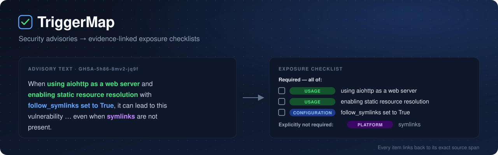
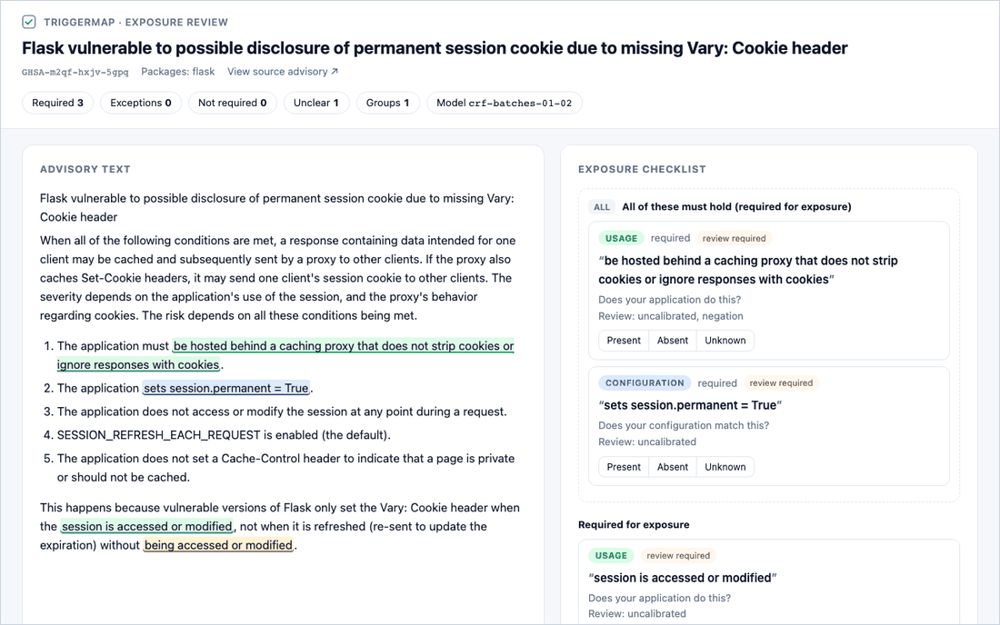
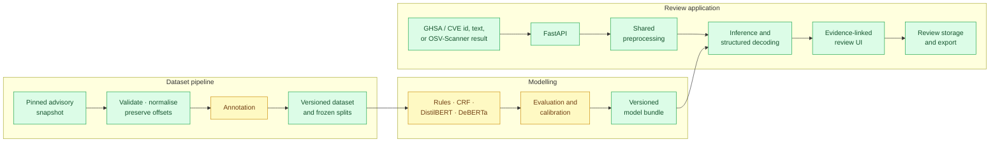

<div align="center">



<br>

[](https://github.com/professor3333/TriggerMap/actions/workflows/ci.yml)
[-8b5cf6)](https://github.com/professor3333/TriggerMap/releases/tag/v0.2.0)
[](https://professor3333.github.io/TriggerMap/)

[](LICENSE)
[](annotations/README.md)

</div>

**TriggerMap reads a security advisory for a Python package and tells you under what conditions
the vulnerability is reachable.** A dependency scanner such as
[OSV-Scanner](https://github.com/google/osv-scanner) says *which* package is affected. TriggerMap
extracts the conditions stated in the advisory text (a setting, a feature in use, the attacker's
access, a platform), with their role and logic. Every item links to the exact words that state
it, so a developer can check it against their deployment and export the record.

<div align="center">

<a href="https://professor3333.github.io/TriggerMap/"></a>

<sub><b><a href="https://professor3333.github.io/TriggerMap/">Try the live demo →</a></b> &nbsp;Real output of the released model on a Flask advisory, mistakes included: it finds two of the five listed conditions and marks one background phrase as required. One illustrative advisory, not an accuracy claim.</sub>

</div>

<div align="center">

[What it extracts](#what-it-extracts) ·
[Quickstart](#quickstart) ·
[Results](#results) ·
[How it works](#how-it-works) ·
[Limitations](#limitations) ·
[Documentation](#documentation)

</div>

## What it extracts

Each checklist item is a contiguous **span of the advisory text** with a category and a role.
Items can belong to a logical group.

> When **using aiohttp as a web server** and **enabling static resource resolution** with
> **`follow_symlinks` set to True**, it can lead to this vulnerability.

| Span | Category | Role | Group |
|---|---|---|---|
| using aiohttp as a web server | `USAGE` | `REQUIRED` | `ALL` |
| enabling static resource resolution | `USAGE` | `REQUIRED` | `ALL` |
| follow_symlinks set to True | `CONFIGURATION` | `REQUIRED` | `ALL` |

The three spans form one `ALL` group: every one of them must hold. The full label set:

| | Labels |
|---|---|
| **Category** | `CONFIGURATION` · `USAGE` · `ACCESS` · `PLATFORM` |
| **Role** | `REQUIRED` (includes required *absences*) · `EXCEPTION` · `NOT_REQUIRED` · `UNCERTAIN` |
| **Group** | `ALL` · `ANY` · `UNRESOLVED` |

Three rules shape everything else:

- **Every item has evidence.** Checklist wording is the source span plus a fixed template.
  Nothing is paraphrased, and there is no LLM in the serving path.
- **Missing information stays visible.** "No explicit conditions found" is never shown as "not
  affected", and uncertain or unsupported structure is routed to *Review required*.
- **A person decides.** TriggerMap suggests items for review. It does not judge whether a
  deployment is vulnerable.

## Quickstart

Requires [uv](https://docs.astral.sh/uv/) and Git.

```bash
git clone https://github.com/professor3333/TriggerMap.git && cd TriggerMap
uv sync --extra baselines --extra serve    # Python 3.12 environment from uv.lock
uv run pytest -m "not slow"                # offline test suite

# Rebuild the pinned corpus: 6,350 PyPI advisories, ~360 MB download
uv run triggermap ingest fetch --commit 1912cbd6ce9d4cb141636adc4abafb4eb77a93e6
uv run triggermap ingest build

# Render an evidence-linked review page for one advisory
uv run triggermap view GHSA-m2qf-hxjv-5gpq --out review.html

# Run the review application at http://127.0.0.1:8000 (--port to change)
uv run triggermap app sync
uv run triggermap app create-user alice    # prints an API token once
uv run triggermap app run
```

Training, evaluation, annotation and GPU commands are in [`docs/usage.md`](docs/usage.md).
A fresh clone reproduces the corpus, the CRF and the reports byte for byte on macOS and Linux
([`docs/reproducibility.md`](docs/reproducibility.md)).

## Results

Only 22 advisories are hand-labelled. The other 688 annotated records are model drafts, so most
scores measure **agreement with the drafting model, not accuracy**. The held-out test split was
evaluated once, in a declared and logged run:

| System | Typed-condition F1 | Span precision | Span recall | False-prerequisite rate |
|---|---:|---:|---:|---:|
| Rules | 0.048 [0.021, 0.082] | 0.101 | 0.053 | 0.646 |
| **CRF** (default) | **0.193 [0.154, 0.238]** | **0.263** | 0.219 | **0.482** |
| DeBERTa-v3-small | 0.154 [0.125, 0.186] | 0.114 | **0.393** | 0.650 |

<sub>146 model-drafted test records. 95% project-group bootstrap intervals. A condition is correct only when its exact span, category and role all match; a group only when its members and operator match.</sub>

- **The CRF is the default model.** It agrees with the test drafts better than the fine-tuned
  DeBERTa (−0.039 typed F1 for DeBERTa, 95% CI [−0.080, −0.000]) and invents clearly fewer
  prerequisites. The switching rule was fixed before the test set was used.
- **Accuracy is barely measurable.** On the 4 hand-labelled test records no difference is clear,
  so the release targets in [`docs/targets.md`](docs/targets.md) cannot be judged.
- **The reference labels are noisy.** Two model drafting runs of the same 100 documents agree at
  only 0.375 typed F1.
- **New advisories are longer.** The 259 advisories published after the snapshot have a median
  of 515 words, against 79 in the dev documents.
- **Serving is fast.** On a 2 vCPU / 4 GB host the CRF answers in 0.06 s (p95, ~512 tokens) and
  0.14 s (~2,000 tokens) with 276 MB peak memory, and handled 1,000 of 1,000 load-test requests.

Everything else (dev results, calibration, ablations, ONNX/INT8, benchmarks) is in
[`docs/results.md`](docs/results.md).

## How it works



<sub>🟩 built · 🟨 built, limited by model-drafted labels. Training and serving share one preprocessing module, so offsets mean the same thing everywhere.</sub>

- **Text:** Markdown is reduced to canonical text with a character-level map back to the raw
  advisory. Every span is a zero-based, half-open offset pair, checked by a deterministic validator.
- **Models:** deterministic rules, a CRF tagger with logistic-regression category, role and group
  classifiers, and fine-tuned DistilBERT and DeBERTa-v3-small.
- **Review policy:** uncertain roles, unresolved groups, low-confidence items and negation or
  workaround cues are flagged *Review required* ([`configs/review_policy.yaml`](configs/review_policy.yaml)).
- **Application:** one FastAPI process serves the JSON API and the review UI, with SQLite (WAL)
  and append-only review history. Reviews export as JSON or Markdown.
- **Stack:** Python 3.12 · uv · python-crfsuite · scikit-learn · spaCy · PyTorch · Transformers ·
  FastAPI · SQLite · Docker Compose · GitHub Actions.

## Data

- **Source:** [GitHub Advisory Database](https://github.com/github/advisory-database), reviewed
  advisories, pinned to commit `1912cbd6`. Of 36,910 advisories scanned, 6,350 are kept for PyPI.
- **Annotations:** 710 advisories, of which 22 are hand-labelled. Every record states how its
  labels were made ([`docs/dataset_card.md`](docs/dataset_card.md)).
- **Splits:** train 2,450 · dev 2,703 · test 1,197. Advisories sharing a package, repository,
  alias or near-duplicate text stay in one split, and test holds the newest project groups
  ([`docs/splits.md`](docs/splits.md)).
- **Committed:** annotations, split manifests and the snapshot manifest. Raw data, the processed
  corpus and model weights are rebuilt or downloaded, not committed.

## Deployment

One CPU host runs Docker Compose: a Caddy proxy, the app, SQLite on a volume and Prometheus. A
release pins the image, model bundle and review policy together. Rollback restores all three at
once, and it is tested by a drill ([`docs/deployment.md`](docs/deployment.md)).

| Release | Contents |
|---|---|
| [v0.2.0 (preview)](https://github.com/professor3333/TriggerMap/releases/tag/v0.2.0) | Current. Serving image and the CRF bundle. [Release notes](docs/release_notes/v0.2.0.md) |
| [model-deberta-3-run3](https://github.com/professor3333/TriggerMap/releases/tag/model-deberta-3-run3) | Fine-tuned DeBERTa-v3-small weights. Not the default model |
| [v0.1.0 (preview)](https://github.com/professor3333/TriggerMap/releases/tag/v0.1.0) | First release of the CRF. [Release notes](docs/release_notes/v0.1.0.md) |

## Project status

| Phase | Status |
|---|---|
| 1 · Ingestion, label schema, pilot | ✅ done |
| 2 · Rules and CRF baselines, evaluator | ✅ done |
| 3 · Transformers (DistilBERT, DeBERTa) | 🟨 trained on model drafts; the CRF stays ahead on test |
| 4 · Calibration, review policy, robustness | 🟨 built; thresholds not applied without hand labels |
| 5 · API, review UI, storage, Docker, rollback | ✅ done |
| 6 · Benchmarks, ONNX, hosted deployment | 🟨 CRF meets every serving target; transformers not measured on the target host |
| 7 · Test evaluation, reproduction, demo | 🟨 done within the label limits; no usability study |

Each Definition of Done item, with its evidence:
[`docs/definition_of_done.md`](docs/definition_of_done.md).

## Limitations

- **Most labels are model drafts.** 22 records are hand-labelled (10 dev, 4 test), and no more
  will come. Most scores are agreement, not accuracy, and the release targets cannot be judged.
- **The reference labels are unstable.** Two drafting runs agree at only 0.375 typed F1
  ([`reports/drafter-consistency/`](reports/drafter-consistency/README.md)).
- **One annotator.** There is no inter-annotator agreement and no repeat annotation.
- **Independence is not guaranteed.** Advisories are copied across packages, aliases and
  revisions. Grouping removes the duplicates it can detect, but some leakage risk remains.
- **Narrow scope:** GitHub-reviewed advisories, PyPI only, English only. The test split measures
  temporal and project shift.
- **Rare structure is weak.** Group exact match is 0 for every system. EXCEPTION and NOT_REQUIRED
  conditions are rarely right, and `UNCERTAIN` and `UNRESOLVED` are unsupported.
- **Nested and cross-window logic is marked unresolved, not modelled.** 71% of advisories published
  after the snapshot need more than one 512-token window
  ([`reports/prospective/`](reports/prospective/README.md)).
- **Absence of an extracted condition is not evidence that none exists.**
- **Exported runtimes:** dynamic INT8 fails the accuracy gate for DeBERTa.
- **No usability study.** No developer participants are available, so none will be run.
  Walkthroughs by AI models are not reported as usability evidence.

## Documentation

| Topic | Where |
|---|---|
| All results | [`docs/results.md`](docs/results.md) · [`reports/`](reports) |
| Commands | [`docs/usage.md`](docs/usage.md) |
| Metrics and correctness | [`docs/evaluation.md`](docs/evaluation.md) · [`docs/targets.md`](docs/targets.md) |
| Models | [`docs/model_card.md`](docs/model_card.md) · [`docs/training_on_gpu.md`](docs/training_on_gpu.md) |
| Data and labelling | [`docs/dataset_card.md`](docs/dataset_card.md) · [`docs/annotation_guidelines.md`](docs/annotation_guidelines.md) · [`docs/splits.md`](docs/splits.md) |
| Operations | [`docs/deployment.md`](docs/deployment.md) · [`docs/benchmarks.md`](docs/benchmarks.md) · [`docs/reproducibility.md`](docs/reproducibility.md) |

<details>
<summary><b>Repository layout</b></summary>

```text
src/triggermap/
├── schema/      label inventory (single source of truth) and deterministic validator
├── text/        Markdown → canonical text with offset map, segmentation
├── ingest/      pinned snapshot, OSV parsing, PyPI filter, manifests
├── corpus/      statistics, leakage groups, near-duplicates, frozen splits, sampling
├── annotate/    Label Studio tasks and validated import
├── models/      rules · CRF · transformer · experiment runner
├── eval/        metrics, cluster bootstrap, reports
├── serve/       FastAPI app, review UI, SQLite storage, review policy, exports
└── cli.py       `triggermap` command
annotations/     versioned annotations and sample manifests (CC BY 4.0)
splits/          frozen split manifests
reports/         measured results
demo/            static demo pages (GitHub Pages)
deploy/          Compose stack, smoke test, rollback drill
tests/           unit, property-based and end-to-end tests
```

</details>

## License

- **Code:** [MIT](LICENSE).
- **Advisory text and annotations:** [CC BY 4.0](https://creativecommons.org/licenses/by/4.0/).
  Annotations are modified material derived from the advisories. Attribution and details are in
  [`annotations/README.md`](annotations/README.md).

Built on the [GitHub Advisory Database](https://github.com/github/advisory-database), the
[OSV schema](https://ossf.github.io/osv-schema/) and [Label Studio](https://labelstud.io/).
