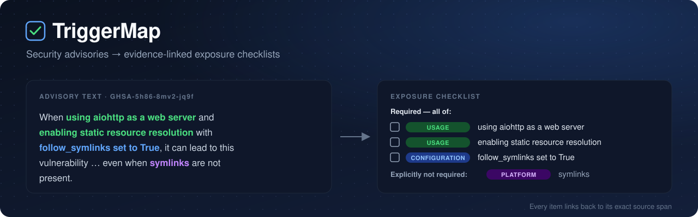
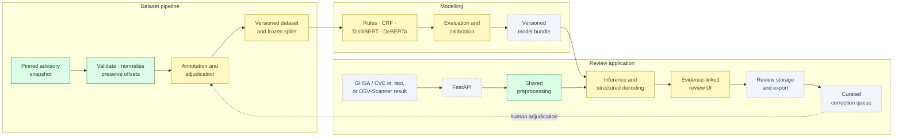
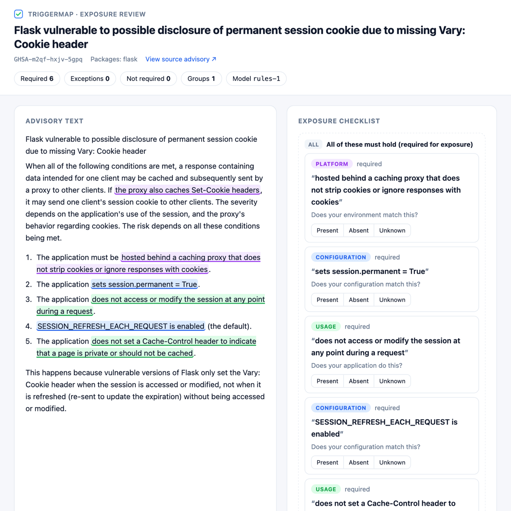

<div align="center">



<br>

[](https://github.com/professor3333/TriggerMap/actions/workflows/ci.yml)

[](LICENSE)
[](annotations/README.md)


**Read the advisory. Get the conditions. Check them against your deployment.**

[Architecture](#architecture) ·
[Why](#why-triggermap) ·
[What it extracts](#what-it-extracts) ·
[See it](#see-it) ·
[Principles](#design-principles) ·
[Status](#project-status) ·
[Quickstart](#quickstart) ·
[Data](#data-and-licensing)

</div>

---

## Architecture



<sub>🟩 built · 🟨 in progress · ⬜ planned. Training and serving share one preprocessing module, so offsets mean the same thing everywhere.</sub>

## Why TriggerMap

A vulnerability alert tells you **a dependency is affected**. Whether **your deployment** is
exposed usually depends on conditions buried in the advisory prose:

| Question a developer asks | Typical advisory wording |
|---|---|
| Does it need an optional feature? | "…with `follow_symlinks` set to True" |
| Must the app use a particular interface? | "When using aiohttp **as a web server**…" |
| Does the attacker need an account? | "An **authenticated** user with edit permission…" |
| Must several things hold at once? | Flask's advisory lists **five** jointly necessary conditions |
| Is this a prerequisite or just a workaround? | "Disable the option immediately" is advice, not a condition |

Dependency scanners such as [OSV-Scanner](https://github.com/google/osv-scanner) answer
*which* package is affected. TriggerMap complements them by extracting the **conditions**,
their **logic**, and the **exact sentence** that states each one. Developers can then verify
the conditions against their application and keep a record of the answers.

## What it extracts

Each checklist item is a contiguous **span of the advisory text**. It carries a category and a
role, and may belong to an explicit logical group:

<table>
<tr><th>Category</th><th>Role</th><th>Group</th></tr>
<tr valign="top"><td>

`CONFIGURATION` option or flag values<br>
`USAGE` features, functions, modes used<br>
`ACCESS` what the attacker must have<br>
`PLATFORM` OS, runtime, infrastructure

</td><td>

`REQUIRED` must hold (incl. required *absences*)<br>
`EXCEPTION` if it holds, you are not exposed<br>
`NOT_REQUIRED` the text says it is unnecessary<br>
`UNCERTAIN` the text does not settle it

</td><td>

`ALL` every member must hold<br>
`ANY` one member suffices<br>
`UNRESOLVED` connected, logic unclear

</td></tr>
</table>

<details>
<summary><b>Example record</b> for the aiohttp sentence in the banner</summary>

```json
{
  "advisory_id": "GHSA-5h86-8mv2-jq9f",
  "conditions": [
    {"id": "c1", "span": [5, 34],   "category": "USAGE",         "role": "REQUIRED"},
    {"id": "c2", "span": [39, 74],  "category": "USAGE",         "role": "REQUIRED"},
    {"id": "c3", "span": [80, 107], "category": "CONFIGURATION", "role": "REQUIRED"}
  ],
  "groups": [{"operator": "ALL", "members": ["c1", "c2", "c3"]}]
}
```

Offsets are zero-based and half-open, measured in the canonical text, which has display markup
such as backticks removed. Every canonical character maps back to the raw Markdown, so each
item can be highlighted in the original advisory.

</details>

## See it

<div align="center">

</div>

<sub>`triggermap view GHSA-m2qf-hxjv-5gpq` with the rules baseline. Clicking a checklist item scrolls to and flashes its source span; answers export as JSON or Markdown. This is one illustrative advisory, not an accuracy claim.</sub>

## Design principles

| | Principle | In practice |
|---|---|---|
| 🔗 | **Every claim has evidence** | Checklist wording is the source span plus a fixed template. No generated paraphrase, no LLM in the serving path. |
| 🕳️ | **Missing information stays visible** | "No explicit conditions found" is never shown as "conditions do not apply". Unsupported structure is flagged for review rather than dropped. |
| ↔️ | **Negation scope matters** | "does *not* set Cache-Control" is a required absence; "symlinks need *not* exist" removes a prerequisite. These are different labels. |
| 🧪 | **Honest evaluation** | Project- and alias-grouped splits, a frozen blind test set, bootstrap confidence intervals, and strong baselines. |
| 🧑‍⚖️ | **Humans own the labels** | Gold annotations are hand-made. Reviewer corrections reach training only after adjudication. |

## Project status

| Phase | Scope | Status |
|---|---|:---:|
| 1 · Feasibility | Pinned ingestion, corpus statistics, label schema, offset-preserving preprocessing, pilot sample, annotation tooling | ✅ built |
| 1 · Pilot | 100-document pilot annotation, guideline revision, decision gate | 🟨 in progress |
| 2 · Baselines | Rules baseline, CRF + logistic-regression attributes and groups, evaluator with bootstrap CIs, evidence viewer | ✅ built · scores await pilot labels |
| 3 · Neural models | Frozen leakage-safe splits, annotation batches, DistilBERT and DeBERTa-v3 with span / role / group heads, experiment runner | 🟨 code ready · training awaits labels |
| 4 · Reliability | Group logic, calibration, negation and scope challenge set, error catalogue | ⏳ |
| 5 · Application | FastAPI, review UI, SQLite storage, JSON/Markdown export, Docker, CI/CD | ⏳ |
| 6 · Production | CPU benchmarks, ONNX/INT8, monitoring, hosted release | ⏳ |

Results will be published here only once measured. Until then this README reports no accuracy numbers.

## Quickstart

Requires [uv](https://docs.astral.sh/uv/) and Git.

```bash
git clone https://github.com/professor3333/TriggerMap.git && cd TriggerMap
uv sync                                    # Python 3.12 environment from uv.lock
uv run pytest -m "not slow"                # offline test suite
```

**Rebuild the corpus** from the pinned snapshot:

```bash
uv run triggermap ingest fetch --commit 1912cbd6ce9d4cb141636adc4abafb4eb77a93e6   # sparse clone, ~360 MB
uv run triggermap ingest build             # PyPI filter, withdrawn excluded, malformed quarantined
uv run triggermap corpus stats             # writes docs/corpus_stats.md
```

`ingest build` writes `data/processed/advisories.jsonl` (not committed) and the committed
[`data/manifests/snapshot.json`](data/manifests/snapshot.json). The manifest records the source
commit, every filtering count, each quarantined file with its reason, and the SHA-256 of the
output. Rebuilding from the same commit reproduces it byte for byte.

**Extract and review** (rules baseline; no labels needed):

```bash
uv sync --extra baselines                  # adds CRF, scikit-learn and spaCy for the trained baseline
uv run triggermap view GHSA-m2qf-hxjv-5gpq --out review.html          # evidence-linked review page
uv run triggermap view --text-file advisory.md --out review.html      # any pasted advisory text
uv run triggermap predict --out data/predictions/rules-2.jsonl        # whole corpus, validated output
```

**Train and evaluate** (once gold labels exist):

```bash
uv run triggermap train --gold annotations/pilot/pilot-1.jsonl --out artifacts/crf-1
uv run triggermap predict --model crf --model-dir artifacts/crf-1 --out data/predictions/crf-1.jsonl
uv run triggermap evaluate annotations/pilot/pilot-1.jsonl data/predictions/crf-1.jsonl --out reports/crf-1.md
```

**Transformers** (once gold labels exist; DistilBERT, DeBERTa-v3-small; GPU recommended, see
[`docs/training_on_gpu.md`](docs/training_on_gpu.md)):

```bash
uv sync --extra neural
uv run triggermap experiment --config configs/experiments/deberta.toml --dry-run      # planned runs
uv run triggermap experiment --config configs/experiments/deberta.toml \
    --gold annotations/pilot/pilot-1.jsonl annotations/batches/batch-0*.jsonl          # lr x seed grid
uv run triggermap predict --model transformer --model-dir artifacts/experiments/<run> --out preds.jsonl
```

Each run records the pinned base-checkpoint revision, the training-data and split hashes,
hyperparameters, seed, per-epoch dev metrics, training time and peak GPU memory (and logs
them to MLflow). Reports carry leakage-group bootstrap intervals and mean ± SD across seeds.

**Annotate** with [Label Studio](https://labelstud.io/):

```bash
uv run triggermap corpus sample-pilot      # reproduce the pilot sample (seed 20261020)
uv run triggermap annotate tasks           # Label Studio tasks for the sample
uv run triggermap annotate import data/label_studio/export.json --annotator A1
```

The importer validates every exported annotation (offsets, labels, groups, document status),
writes only clean records, and reports problems, label counts and annotation pace. The procedure
is in [`docs/pilot_protocol.md`](docs/pilot_protocol.md), and the labelling rules are in
[`docs/annotation_guidelines.md`](docs/annotation_guidelines.md).

## How results will be measured

A condition counts as correct only when its **exact span, category and role** all match the gold
annotation. A group counts as correct only when its **members and operator** both match. Reports
give exact span P/R/F1, typed micro-F1, role macro-F1 with per-class support, group exact match,
complete-document exact match (separately for advisories with and without conditions), the
**false-prerequisite rate**, the **reversed-meaning rate**, and precision versus coverage. All of
these come with document- or project-clustered bootstrap confidence intervals.
"No explicit conditions found" is never treated as "not affected": TriggerMap supports review,
it does not decide whether a deployment is vulnerable.

## Data splits

Every advisory is assigned to a **train, dev or test pool before scaled annotation**, so
labels can never leak across splits. Advisories sharing a package, an upstream repository,
an alias, or identical or near-identical text (MinHash, Jaccard ≥ 0.6) always land in the
same pool. Test holds the **newest project groups**, so test scores measure temporal and
project shift. Training code reads only the train pool. Evaluating on test requires an
explicit `--release-evaluation` reason, and every such run is logged.

| Pool | Advisories | Project groups | Published |
|---|---:|---:|---|
| train | 2,450 | 347 | 2018 → 2026 |
| dev | 2,703 | 423 | 2018 → 2026 |
| test | 1,197 | 558 | 2024-04 → 2026 |

Details: [`docs/splits.md`](docs/splits.md) · annotation batches:
[`docs/annotation_plan.md`](docs/annotation_plan.md).

## Corpus at a glance

Snapshot `1912cbd6` of the GitHub Advisory Database, reviewed advisories only:

| 36,910 | 6,350 | 1,528 | 236 | 0 |
|:---:|:---:|:---:|:---:|:---:|
| advisories scanned | PyPI advisories kept | distinct packages | withdrawn, excluded | quarantined |

More detail (lengths, structure, cue coverage, years, top packages) is in
[`docs/corpus_stats.md`](docs/corpus_stats.md).

## Repository layout

```text
src/triggermap/
├── schema/      label inventory (single source of truth) + deterministic validator
├── text/        Markdown → canonical text with offset map, segmentation, shared entry point
├── ingest/      pinned snapshot, OSV parsing, PyPI filter, quarantine, manifests
├── corpus/      statistics, cues, leakage groups, near-duplicates, frozen splits, batch sampling
├── annotate/    Label Studio tasks and validated import
├── models/      rules baseline · CRF + logistic regression · transformer (encoder + span,
│                role and group heads, windows, bundles) · experiment runner
├── eval/        metrics, cluster bootstrap, Markdown reports
├── serve/       evidence-linked review page (Jinja template, escaped, CSP)
└── cli.py       `triggermap` command
configs/         Label Studio config · experiment configs (pinned checkpoint revisions)
splits/          frozen split manifest (pool-v1)
annotations/     versioned annotations and sample manifests (CC BY 4.0)
data/manifests/  committed snapshot manifest (raw and processed data are rebuilt, not committed)
docs/            guidelines, pilot protocol, corpus statistics
tests/           unit, property-based, synthetic end-to-end and real-export regression tests
```

## Data and licensing

- **Source:** [GitHub Advisory Database](https://github.com/github/advisory-database), reviewed
  advisories in the PyPI ecosystem, pinned to commit
  `1912cbd6ce9d4cb141636adc4abafb4eb77a93e6`. Records use the
  [OSV schema](https://ossf.github.io/osv-schema/).
- **Advisory text and annotations:** [CC BY 4.0](https://creativecommons.org/licenses/by/4.0/).
  Annotations are modified material derived from the advisories; attribution and details are in
  [`annotations/README.md`](annotations/README.md).
- **Code:** [MIT](LICENSE).

## Acknowledgements

Built on the [GitHub Advisory Database](https://github.com/github/advisory-database), the
[OSV schema](https://ossf.github.io/osv-schema/) and [Label Studio](https://labelstud.io/).
