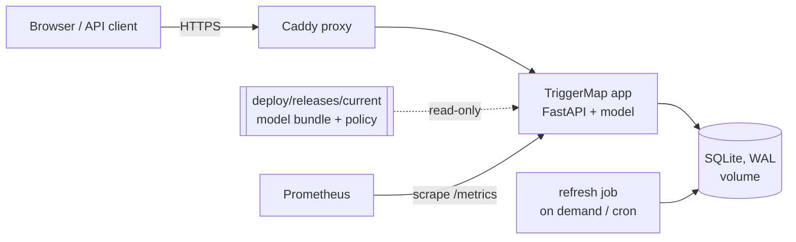

# Deployment and rollback

TriggerMap runs as a small Docker Compose stack on **one CPU host**. Training never runs
there; only a versioned release (image, model bundle and review policy) is deployed.



| Service | Image | Notes |
|---|---|---|
| `app` | the TriggerMap release image | read-only root filesystem, non-root user, `/data` volume, release mounted read-only, port on loopback only |
| `proxy` | `caddy:2.11.7-alpine` | automatic HTTPS for `DOMAIN`, security headers, `/metrics` not exposed |
| `prometheus` | `prom/prometheus:v3.15.0` | scrapes `app:8000/metrics`; reach it through an SSH tunnel |
| `refresh` | the release image (profile `jobs`) | refreshes the advisory snapshot and reloads the app database |

## Releases

A release is an immutable directory under `deploy/releases/` (not in git):

```text
deploy/releases/
├── v0.2.0/
│   ├── release.json         image, model kind and id, weights SHA-256, preprocessing and policy versions
│   ├── review_policy.yaml   calibration and thresholds that belong to this model
│   └── model/               model bundle (absent for the rules model)
├── current -> v0.2.0        the active release (atomically replaced symlink)
├── .env                     TRIGGERMAP_IMAGE and TRIGGERMAP_RELEASE for compose
└── history.jsonl            every activation
```

The app reads its model, bundle and policy from `/release`. **It refuses to start if the
bundle's weights do not match the digest in `release.json`.** `/readyz` reports the release,
model id, weights digest, preprocessing version, review-policy version, calibration, label
inventory and advisory snapshot, so you can always see what is serving.

## First deployment

On a Linux VM with Docker and the Compose plugin. A 2 vCPU / 4 GB machine is the target.
Open only ports 22, 80 and 443, and point a DNS record for your domain at the host.

```bash
git clone https://github.com/professor3333/TriggerMap.git /srv/triggermap && cd /srv/triggermap
curl -LsSf https://astral.sh/uv/install.sh | sh && uv sync --extra serve

# 1. Assemble a release (image by digest from the GitHub release, or a local build).
uv run triggermap release create v0.2.0 \
    --image ghcr.io/professor3333/triggermap@sha256:<digest> --model rules
uv run triggermap release activate v0.2.0

# 2. Start the stack.
export DOMAIN=triggermap.example.org
docker compose -f deploy/compose.yaml --env-file deploy/releases/.env up -d

# 3. Load the advisory snapshot (pin it for reproducibility).
SNAPSHOT_COMMIT=1912cbd6ce9d4cb141636adc4abafb4eb77a93e6 \
  docker compose -f deploy/compose.yaml --env-file deploy/releases/.env run --rm refresh

# 4. Create users (each token is printed once).
docker compose -f deploy/compose.yaml --env-file deploy/releases/.env exec app \
    triggermap app create-user deploy-check
docker compose -f deploy/compose.yaml --env-file deploy/releases/.env exec app \
    triggermap app create-user <reviewer>

# 5. Verify the deployment.
TRIGGERMAP_VERIFY_TOKEN=<deploy-check token> uv run triggermap app verify
```

`triggermap app verify` fails unless `/readyz` matches `release.json` exactly (release, model
id, weights digest, preprocessing version, review-policy version, accept threshold and label
inventory). It then pushes a bundled sample advisory through extraction, review, a retried
save (which must not duplicate) and export, and reads the saved review back.

For transformer releases, build the image with `--build-arg EXTRAS="serve neural"`. uv
installs CPU-only PyTorch from the lockfile.

## Scheduled refresh

Advisories change. Refresh the snapshot daily from the host's crontab:

```cron
17 3 * * * cd /srv/triggermap && docker compose -f deploy/compose.yaml --env-file deploy/releases/.env run --rm refresh >> /var/log/triggermap-refresh.log 2>&1
```

The refresh only reloads advisory text; it never retrains or changes the model. Saved reviews
keep their text hash, and the review page flags any advisory whose text changed since it
was reviewed.

## Updating

```bash
uv run triggermap release create v0.3.0 --image ghcr.io/professor3333/triggermap@sha256:<new> \
    --model transformer --model-dir /srv/bundles/deberta-1 --review-policy /srv/bundles/deberta-1/review_policy.yaml
uv run triggermap release activate v0.3.0 --apply      # recreates only the app container
uv run triggermap app verify
```

## Rollback

```bash
uv run triggermap release rollback --apply
uv run triggermap app verify
```

Rollback repoints `current` **and** switches the image in one step, so the previous
application always runs with its own model bundle, tokenizer, preprocessing version,
calibration and thresholds. Saved reviews are untouched and keep the versions they were made
with.

The procedure is exercised by a drill that activates two releases, rolls back, and verifies
each step, including that reviews saved along the way survive:

```bash
TRIGGERMAP_HOST_PORT=8000 deploy/rollback_drill.sh <release-a> <release-b>
```

Last run (2026-10-20, local Docker): rules release `r1`, then CRF release `r2` (different
image, bundle and policy), then rollback to `r1`. Every step verified, in 20 seconds total.

## Backups

The database is a single SQLite file in the `app-data` volume. Take a consistent online
backup and copy it off the host:

```bash
docker compose -f deploy/compose.yaml --env-file deploy/releases/.env exec app python -c \
  "import sqlite3; s=sqlite3.connect('/data/triggermap.db'); d=sqlite3.connect('/data/backup.db'); s.backup(d); d.close()"
docker cp "$(docker compose -f deploy/compose.yaml --env-file deploy/releases/.env ps -q app)":/data/backup.db ./triggermap-$(date +%F).db
```

## Monitoring

Prometheus listens only on the compose network. Query it from the host with
`docker compose -f deploy/compose.yaml --env-file deploy/releases/.env exec prometheus
wget -qO- 'http://localhost:9090/api/v1/query?query=up'`, or add a loopback port mapping
and use an SSH tunnel.

Useful series: `triggermap_requests_total{route,status}`, `triggermap_request_seconds`,
`triggermap_input_chars`, `triggermap_conditions`, `triggermap_empty_extractions_total`,
`triggermap_predicted_roles_total{role}`, `triggermap_review_required_total`,
`triggermap_cache_total{result}` and `triggermap_errors_total{code}`. Drift in these numbers
is a prompt to review samples by hand: metrics alone cannot show accuracy.

## Privacy and security

- Request bodies (pasted advisories, answers) are never logged. The access log records
  method, route, status, timing and byte counts only.
- API tokens are stored only as SHA-256 hashes. Browser sessions use an HttpOnly,
  SameSite=Strict cookie, and every state change also needs an `Idempotency-Key` header.
- Pages use a strict Content-Security-Policy (no inline script or style, no eval).
- Containers run as a non-root user with read-only root filesystems.
